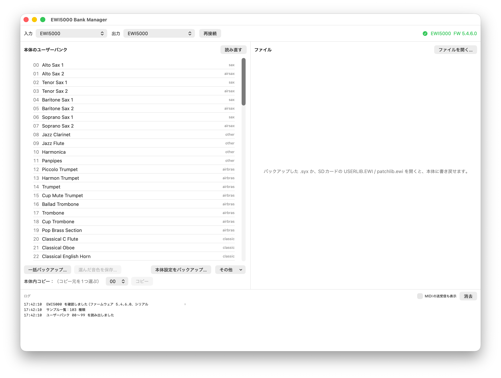
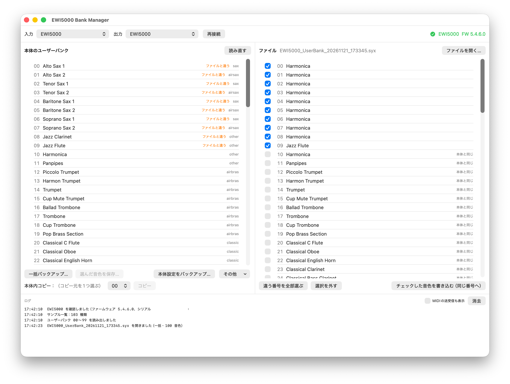
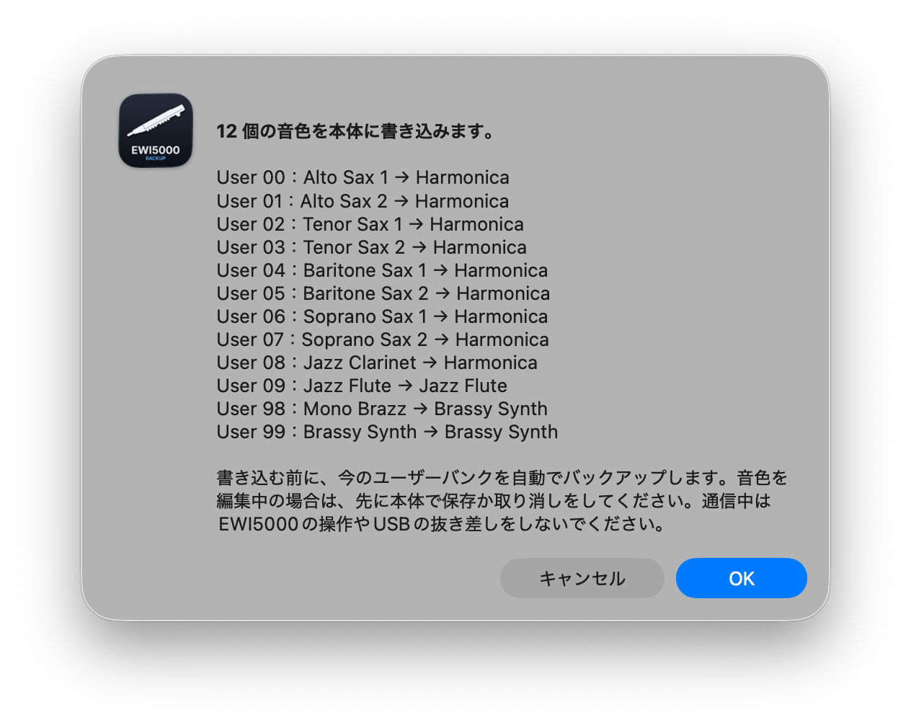

# EWI5000_BackupTool（EWI5000 Bank Manager for Mac）

なんとなく作ったMac版のEWI5000ユーザープリセットのバックアップツールです。
ClaudeCodeでつくってます。
ソースとかよくわかりません（笑）

AKAI Professional EWI5000 のユーザーバンク（00〜99）を、USB MIDI でバックアップ・復元する macOS アプリです。
A macOS app to back up and restore the AKAI EWI5000 user bank (00–99) over USB MIDI.

> **非公式ツールです。** AKAI Professional / inMusic Brands とは一切関係ありません。
> Windows 版 [shingoaoki1985/ewi5000-bank-manager](https://github.com/shingoaoki1985/ewi5000-bank-manager) に触発されて作りましたが、元アプリのコードは使っていません。実機と公式 Sound Editor の通信を記録して仕様を調べ、Swift で一から書いています。

---

## スクリーンショット / Screenshots

**接続してユーザーバンクを読み出したところ**


**バックアップファイルを開いたところ**（本体と内容が違う番号に「ファイルと違う」と表示。書き込む番号にチェック）


**書き込む前の確認**（どの番号が何に変わるかを一覧で確認してから書き込み）



---

## ダウンロード / Download

**[⬇ EWI5000_Bank_Manager_Mac_v0.1.1.zip をダウンロード](https://github.com/garage99/EWI5000_BackupTool/raw/main/download/EWI5000_Bank_Manager_Mac_v0.1.1.zip)**（Apple Silicon / Intel 両対応、約 700KB）

`download` フォルダに置いてあります。

1. zip をダブルクリックして展開する
2. 出てきた **EWI5000 Bank Manager.app** を「アプリケーション」フォルダに入れる

### 初回起動のときのお約束（必ずお読みください）

このアプリは DMG 形式ではなく zip で配布しています。また、Apple の有料の開発者登録（Developer ID 署名・公証）をしていないため、**初回はそのままでは開けません**。以下のどちらかの方法で開いてください（2回目からは普通に開けます）。

**方法A：システム設定から許可する（おすすめ）**
1. アプリをダブルクリックする →「開けません」「開発元を確認できません」と出たら「完了」または「キャンセル」で閉じる
2. **システム設定 → プライバシーとセキュリティ** を開く
3. 下のほうの「セキュリティ」欄に出ている「"EWI5000 Bank Manager" は…」の横の **「このまま開く」** を押す
4. もう一度確認が出たら「開く」を押す（Mac のパスワードを求められることがあります）

**方法B：ターミナルを使う**
```
xattr -dr com.apple.quarantine "/Applications/EWI5000 Bank Manager.app"
```
（ダウンロードしたファイルに付く「インターネットから来た印」を外すコマンドです）

> 怪しいと感じた場合は、使わずに、下の「ビルド」の手順で自分でソースからビルドしてください。

---

## 動作環境 / Requirements

| 項目 | 内容 |
|---|---|
| 対応 Mac | Apple Silicon / Intel（ユニバーサル版） |
| 対応 OS | macOS 14 Sonoma 以降を指定してビルド |
| 接続 | EWI5000 を USB ケーブルで直結（ワイヤレス受信機は未確認） |

**動作確認済みの環境は、下の「開発環境」の1台だけです。** 最新の OS と開発ツールで作っているため、**古い macOS や Intel Mac で動く保証はありません。** 動いた／動かなかったという報告は Issues で歓迎します。

## 開発環境 / Development environment

| 項目 | 内容 |
|---|---|
| 開発機 | Mac mini 2024（Apple M4 Pro） |
| 開発ツール | Xcode コマンドラインツール（macOS SDK 27.2）、Swift |
| 言語・フレームワーク | Swift / SwiftUI / CoreMIDI / AppKit（Apple 標準のみ） |
| 確認した EWI5000 | ファームウェア 5.4.6.0 |
| 開発補助 | Claude（Anthropic）でコードを生成・整理 |

---

## できること / Features
- ユーザーバンク一括バックアップ（.syx）／選んだ音色の個別バックアップ（.syx）
- 本体設定（Control モードの約 330 項目）のバックアップ（.syx と一覧の .csv）
- .syx、または SD カードの `USERLIB.EWI` / `patchlib.ewi` から、選んだ番号へ書き戻し
  - 同じサンプルを使う音色を呼び出し → 違うパラメータだけ NRPN で送る → 読み戻して 266 バイトすべて一致したときだけ保存
  - 書き込み前に今のユーザーバンクを自動バックアップ（`~/Library/Application Support/EWI5000 Bank Manager/バックアップ`）
  - 書き込み後に本体から読み直して照合
- 本体内コピー（User xx → User yy）
- SD カード用 `USERLIB.EWI` の書き出し

## 使い方 / Usage
1. EWI5000 を USB でつないで電源を入れる。**公式 Sound Editor は閉じる**
2. 「接続」を押すと、ユーザーバンクの一覧が表示される
3. まず「一括バックアップ…」で今の状態を保存する
   - バックアップした `.syx` や SD カードの `.ewi` は、ウインドウにドラッグ＆ドロップしても開けます
4. 書き戻しは、最初は消えても困らない番号で試してください

### できないこと・注意
- 本体設定の書き戻しには、まだ対応していません（バックアップのみ）。
- サンプル（波形）そのものは扱いません。SD カードの波形データは別途大切に保管してください。
- 通信中は EWI5000 の操作や USB の抜き差しをしないでください。

---

## 免責事項 / Disclaimer
- このソフトウェアは無保証です。使用によって生じたいかなる損害（音色データの消失、機器の不具合などを含む）についても、作者は責任を負いません。**自己責任でお使いください。**
- 大切な音色は、書き込む前に必ずバックアップしてください。

## 著作権とライセンス / Copyright & License

**Copyright (c) 2026 Garage99. 著作権は放棄していません。**

このソフトウェアは [MIT License](LICENSE) で公開しています。かんたんに言うと：

- ✅ 無料で使ってよい（個人・商用とも）
- ✅ 改変・再配布してよい
- ⚠️ **改変・再配布するときは、著作権表示（`Copyright (c) 2026 Garage99`）とライセンス文（LICENSE ファイル）を必ず残してください**
- ⚠️ 無保証（上の免責事項のとおり）

**お願い：** 改変版や派生物を公開する場合は、README などに**引用元として本リポジトリ（https://github.com/garage99/EWI5000_BackupTool）を明記**してください。

### 使っているもの（第三者のソフトウェア・素材）
| もの | ライセンス | 備考 |
|---|---|---|
| Swift / SwiftUI / CoreMIDI / AppKit | Apple の開発ツール・OS 標準 | 外部ライブラリは使っていません |
| Inter フォント | SIL Open Font License 1.1 | アプリアイコンの文字に使用（画像として埋め込み。フォントファイルは同梱していません） |

GPL など、改変版にもソース公開を義務づけるライセンスのコードは含まれていません。

### 商標 / Trademarks
AKAI Professional、EWI、EWI5000 は inMusic Brands, Inc. の商標または登録商標です。本ソフトウェアは同社とは関係がなく、同社の承認や保証を受けたものではありません。アイコンは製品の形をもとに描いた独自のシルエットで、同社のロゴは使用していません。

---

## 通信仕様のメモ / Protocol notes
詳しくは `Sources/EWIProtocol.swift` の先頭にまとめています。

| 内容 | 送信 | 応答 |
|---|---|---|
| ユーザー/プリセットバンク | `F0 47 7F 20 02 00 03 F7` | `02 00 06` + 266×128 |
| 今の音色 | `F0 47 7F 20 02 00 07 F7` | `02 00 08` + 266 + bank + program |
| 保存 | `F0 47 7F 20 02 00 0A bank program F7` | – |
| 音色選択 | `B0 00 00` `B0 20 bank` `C0 program`（bank 0=Preset, 1=User） | – |
| パラメータ n | NRPN `63 00` `62 n` `06 msb` `26 lsb` → 音色データの 10+2n バイト目 | – |
| 本体設定一覧 | Controlモード（`00 00 06 00`）で `01 00 05` / `01 01 05 01` | `01 41 04` + 値・最小・最大・初期値 + 名前 |

## ビルド / Build
```
./build.sh
```
Xcode（またはコマンドラインツール）が必要です。`dist/` にアプリと配布用 zip ができます。
ビルド時に自己テスト（模擬 EWI5000 を相手にした読み出し・復元・コピー）を実行します。

## 更新履歴 / Changelog
- **v0.1.1**：.syx / .ewi のドラッグ＆ドロップに対応
- **v0.1.0**：最初の公開版

## 謝辞 / Acknowledgements
- [shingoaoki1985/ewi5000-bank-manager](https://github.com/shingoaoki1985/ewi5000-bank-manager)（Windows 版）— このツールを作るきっかけになりました。
